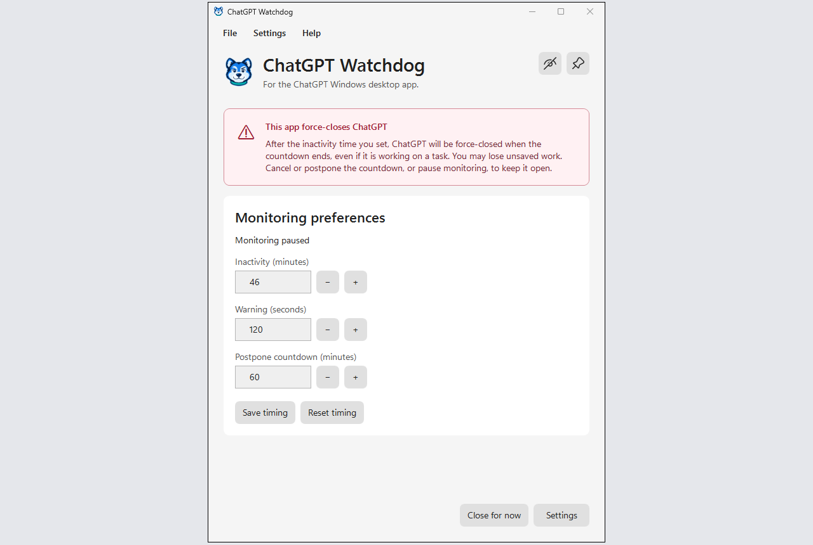
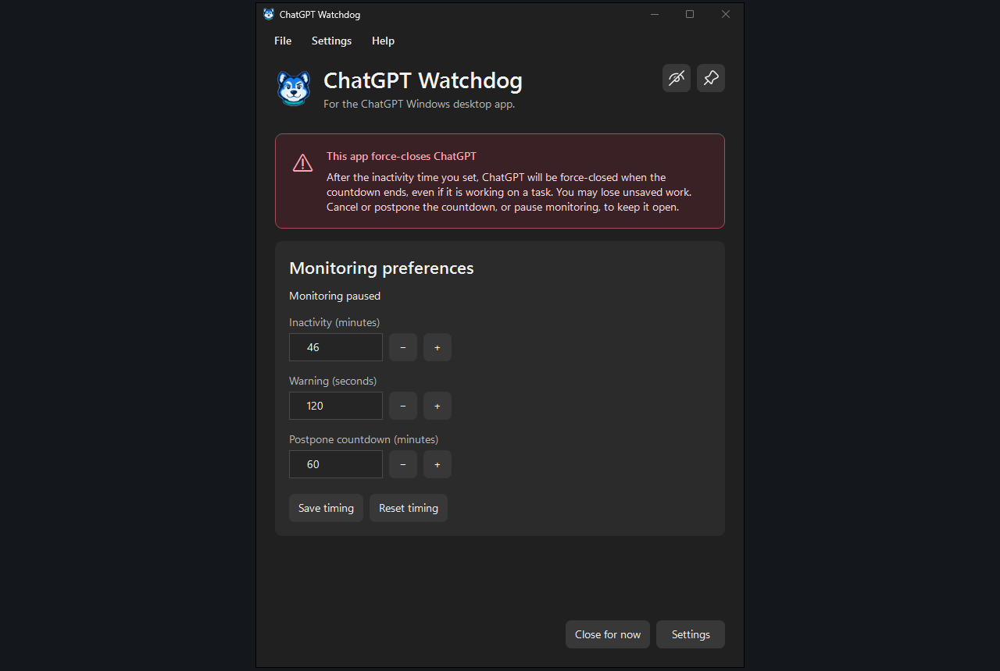
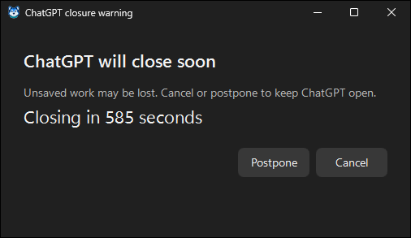
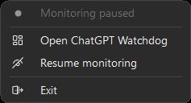
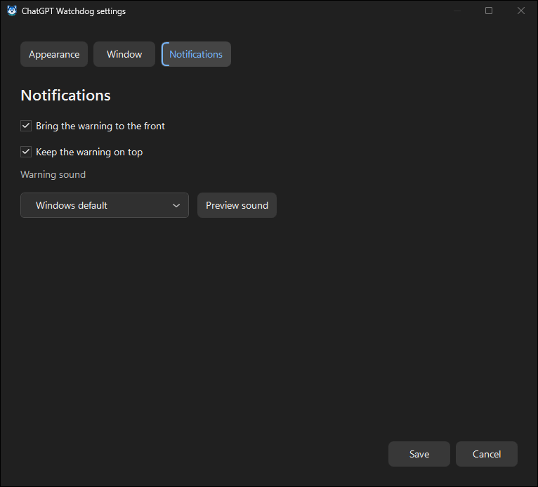
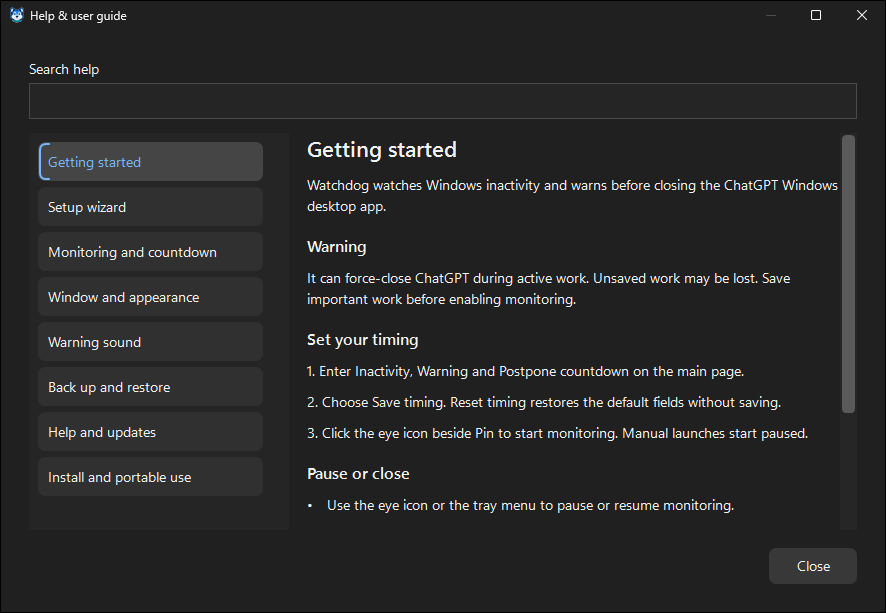
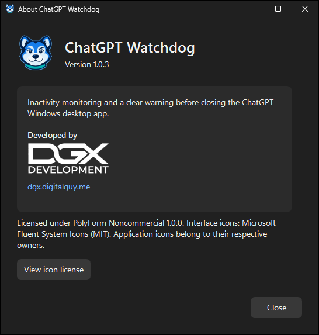

# ChatGPT Watchdog

A Windows utility that force-closes the **ChatGPT Windows desktop app** after computer inactivity. It helps prevent the app being left running after you walk away. **It does not close ChatGPT in a web browser.**

## Current release

[Version 1.0.3](https://github.com/DGX-Development/ChatGPT-Watchdog/releases/tag/v1.0.3)

[Windows installer](https://github.com/DGX-Development/ChatGPT-Watchdog/releases/download/v1.0.3/ChatGPT-Watchdog-1.0.3-Setup.exe) | [Portable ZIP](https://github.com/DGX-Development/ChatGPT-Watchdog/releases/download/v1.0.3/ChatGPT-Watchdog-1.0.3-Portable.zip) | [SHA-256 checksums](https://github.com/DGX-Development/ChatGPT-Watchdog/releases/download/v1.0.3/SHA256SUMS.txt)

> [!WARNING]
> **ChatGPT is force-closed when the warning countdown expires, even during active work. Unsaved work may be lost.** Watchdog measures computer keyboard/mouse inactivity and does not detect active chats or tasks. Pause monitoring before leaving important work unattended.

## Screenshots

Version 1.0.3 with monitoring paused and example timings. Select an image to open its native-size capture.

| Light appearance | Dark appearance |
| --- | --- |
|  |  |

### Countdown warning

The warning gives you time to cancel or postpone closure. This capture uses an extended warning interval.

### Notification-area menu

Open the app, resume or pause monitoring, or exit from the tray menu. The status shown here is paused.

### Settings, Help and About

Current version 1.0.3, captured from the release executable with monitoring paused. Select an image to view it at native size.

| Notification settings | Help and user guide | About |
| --- | --- | --- |
|  |  |  |

## Features

- Default 45-minute inactivity threshold, 120-second warning and 60-minute postponement.
- Cancel or postpone a countdown, or pause monitoring from the tray.
- Optional Windows or custom WAV sound, foreground request and always-on-top warning.
- System, Light and Dark appearance.
- Optional per-user startup at sign-in, controlled in Settings > Window.
- Separate user settings, imported sounds and shutdown logs.

Monitoring can continue while Windows is locked, when its warning is not visible. It cannot run while the computer is asleep or hibernating. Manual launches start paused. Enabled sign-in startup starts monitoring with saved timings.

## Getting started

Run the Windows installer or extract the complete portable ZIP to a permanent folder and run **ChatGPT-Watchdog.exe**. Both downloads include the .NET runtime.

Fresh profiles open setup. Set timings on the main page and choose **Save timing**. Use the eye icon beside Pin to start monitoring when ready. Settings > Window controls startup and tray behavior. Keep all supplied licenses and notices. Updates are installed manually.

The application is unsigned. Windows may request a security check. A SHA256 checksum accompanies the download. A specific malware detection should be investigated separately; do not bypass it as an ordinary unfamiliar-app notice.

## Basic use

1. Open the main window from the tray or executable. Manual launches start paused.
2. Set timings and choose **Save timing**. **Reset timing** restores default fields without saving.
3. Use the eye icon beside Pin to start or pause monitoring. Cancel or postpone warnings to keep ChatGPT open; Windows input also cancels a warning.
4. **File > Exit**, or **Exit** in the tray, stops the current run. Settings > Window controls close/minimize to tray.

**File > Open data folder** opens the active profile. **File > Back up configuration** includes settings and available custom WAV files. Restore pauses monitoring and saves a recovery backup. Installed data lives in `%LOCALAPPDATA%\ChatGPT Watchdog`; portable data stays in `profile` beside the executable. See the [user guide](docs/user-guide.md).

## Documentation

- [User guide](docs/user-guide.md) - settings, warnings, startup, updates and screenshots.
- [Portable instructions](docs/Portable-Readme.txt) - offline instructions included in the download.
- [Development and verification](docs/development.md) - build requirements and safe test modes.
- [Changelog](CHANGELOG.md) - completed changes.

## Help and feedback

Press **F1** for built-in Help. **Help > Report an issue** opens [this project's GitHub issue form](https://github.com/DGX-Development/ChatGPT-Watchdog/issues/new). Review and submit the report yourself; the application does not submit it automatically. When reporting a problem, include the version and reproduction steps; omit personal paths and private data.

[Project page](https://dgx.digitalguy.me/projects/chatgpt-watchdog.html).

About links to the developer website, [DGX.digitalguy.me](https://dgx.digitalguy.me).

## License and attribution

The software is source available under the [PolyForm Noncommercial License 1.0.0](LICENSE), included unchanged. The same text is supplied as **LICENSE.txt** beside the executable. Permitted use, modification and distribution are governed by that license. Microsoft runtime components retain their own licenses and notices, included with self-contained builds.

Typography and layout conventions, shared menu glyphs and small sound/notification helpers follow Backup Reminder. Third-party product names and trademarks retain their applicable rights. This project is independent of OpenAI and does not include the ChatGPT application.
