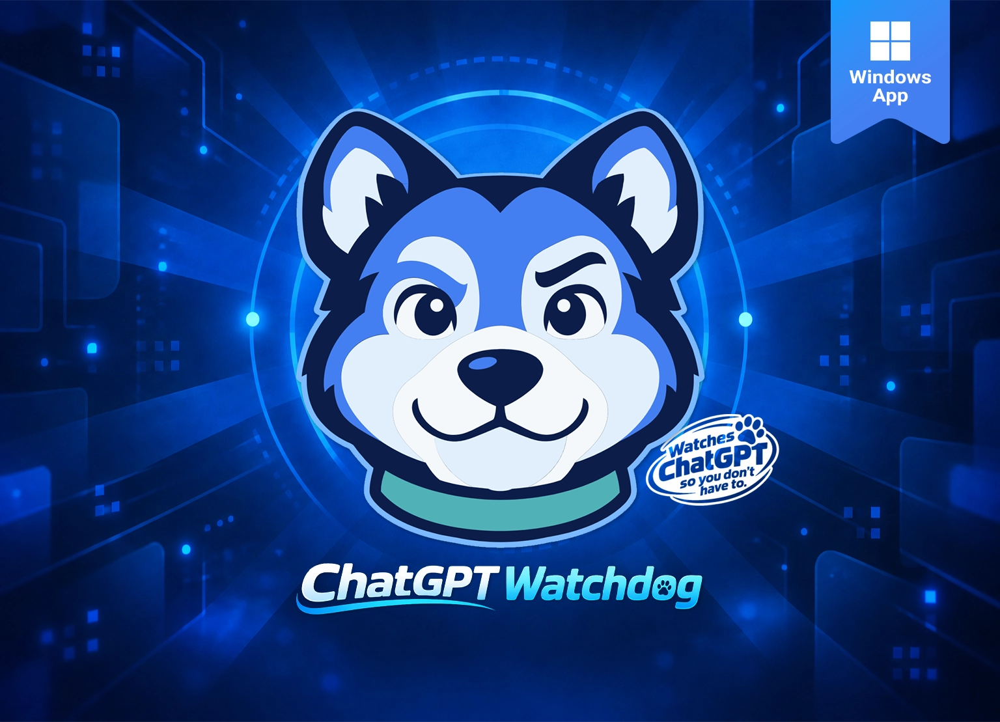
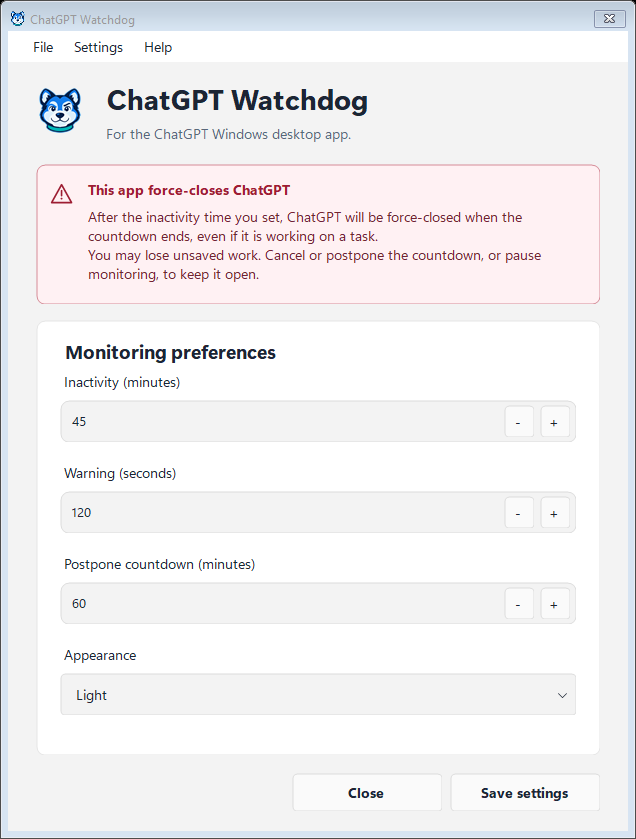
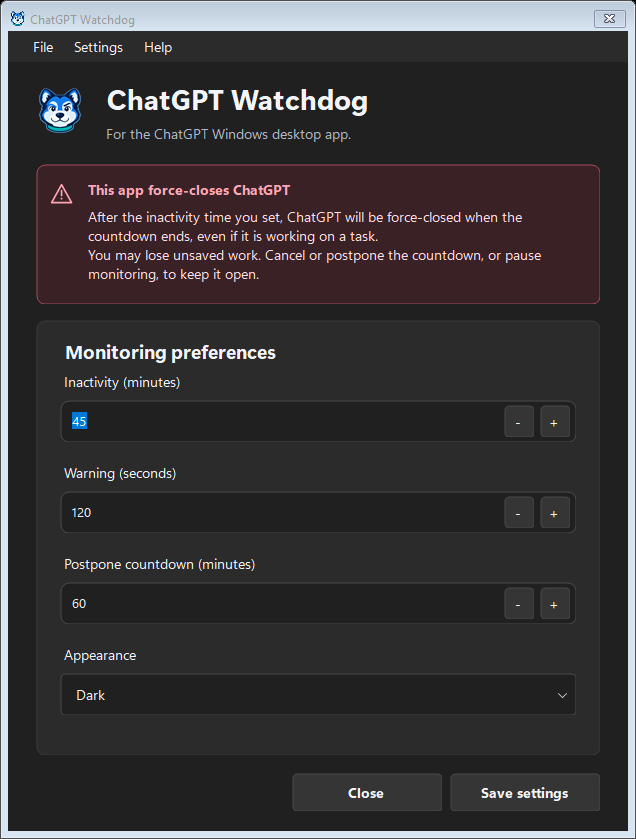

# ChatGPT Watchdog

A Windows utility that force-closes the **ChatGPT Windows desktop app** after computer inactivity. It helps prevent the app being left running after you walk away. **It does not close ChatGPT in a web browser.**

**Version: 0.5.5.** Windows 11 x64. See the [changelog](CHANGELOG.md).

> [!WARNING]
> **ChatGPT is force-closed when the warning countdown expires, even during active work. Unsaved work may be lost.** Watchdog measures computer keyboard/mouse inactivity and does not detect active chats or tasks. Pause monitoring before leaving important work unattended.

## Screenshots

| Light appearance | Dark appearance |
| --- | --- |
|  |  |

[Countdown, notification options, Help and tray screenshots](docs/user-guide.md#screenshots) show version 0.5.4 with generic settings. Version 0.5.5 enables Report an issue. These are native preview captures; Windows title-bar styling can differ on your desktop.

## Features

- Default 45-minute inactivity threshold, 120-second warning and 60-minute postponement.
- Cancel or postpone a countdown, or pause monitoring from the tray.
- Optional Windows or custom WAV sound, foreground request and always-on-top warning.
- System, Light and Dark appearance.
- Per-user startup at sign-in, enabled by default when settings are saved.
- Separate user settings, imported sounds and shutdown logs.

Monitoring can continue while Windows is locked, when its warning is not visible. It cannot run while the computer is asleep or hibernating. Pause and postponement reset when Watchdog restarts.

## Getting started

Download [ChatGPT-Watchdog-0.5.5-win-x64.zip](https://github.com/DGX-Development/ChatGPT-Watchdog/releases/download/v0.5.5/ChatGPT-Watchdog-0.5.5-win-x64.zip) from the [release page](https://github.com/DGX-Development/ChatGPT-Watchdog/releases/tag/v0.5.5). Extract all files to a permanent folder, then run **ChatGPT-Watchdog.exe**. The Windows x64 download includes its .NET runtime; no installer or separately installed runtime is required.

Review the timings and startup preference before choosing **Save settings**. Startup registration occurs when settings are saved, including the startup switch's immediate save. Keep the included app license and Microsoft runtime notices with the executable. There is no automatic updater. For source builds, see the [build instructions](docs/development.md#build).

The application is unsigned. Windows may request a security check. A SHA256 checksum accompanies the download. A specific malware detection should be investigated separately; do not bypass it as an ordinary unfamiliar-app notice.

## Basic use

1. Open settings by double-clicking the dog tray icon.
2. Set the inactivity, warning and postponement durations, then save.
3. Cancel or postpone a warning to keep ChatGPT open. Resumed keyboard/mouse input also cancels it.
4. Use **Pause monitoring** for unattended work. **File > Exit**, or **Exit watchdog** in the tray, stops the current run.

Closing settings leaves monitoring running. Use **Settings > Open data folder** to find your settings, sounds and logs. See the [user guide](docs/user-guide.md) for startup, notifications, safe updates and troubleshooting.

## Documentation

- [User guide](docs/user-guide.md) - settings, warnings, startup, updates and screenshots.
- [Portable instructions](docs/Portable-Readme.txt) - offline instructions included in the download.
- [Development and verification](docs/development.md) - build requirements and safe test modes.
- [Changelog](CHANGELOG.md) - completed changes.

## Help and feedback

Press **F1** for built-in Help. **Help > Report an issue** opens [this project's GitHub issue form](https://github.com/DGX-Development/ChatGPT-Watchdog/issues/new). Review and submit the report yourself; the application does not submit it automatically. When reporting a problem, include the version and reproduction steps; omit personal paths and private data.

[Project page](https://dgx.digitalguy.me/projects/chatgpt-watchdog.html).

About links to the developer website, [DGX.digitalguy.me](https://dgx.digitalguy.me).

## License and attribution

The software is source available under the [PolyForm Noncommercial License 1.0.0](LICENSE), included unchanged. The same text is supplied as **LICENSE.txt** beside the executable. Permitted use, modification and distribution are governed by that license. Microsoft runtime components retain their own licenses and notices, included with self-contained builds.

Typography and layout conventions, shared menu glyphs and small sound/notification helpers follow Backup Reminder. Third-party product names and trademarks retain their applicable rights. This project is independent of OpenAI and does not include the ChatGPT application.
