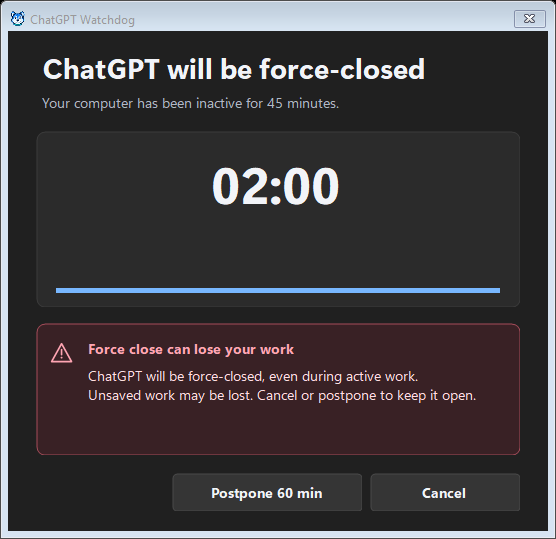
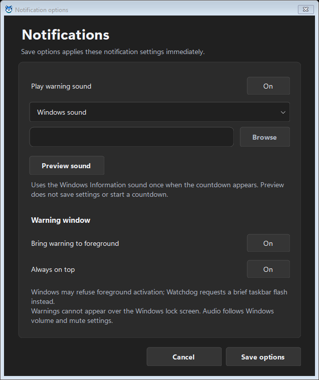
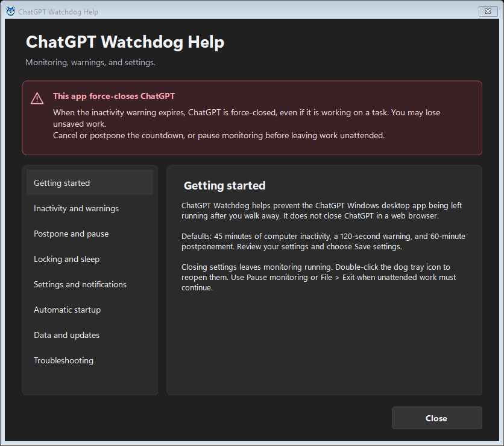
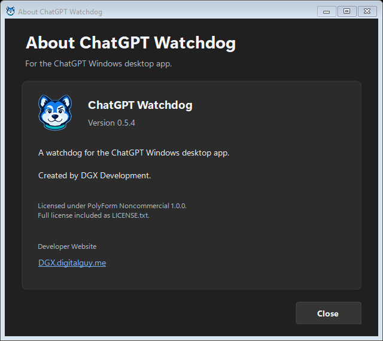
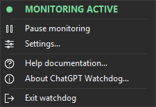
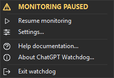

# ChatGPT Watchdog user guide

For the **ChatGPT Windows desktop app**, not ChatGPT in a browser.

> [!WARNING]
> Watchdog force-closes ChatGPT after computer inactivity and an expired warning. Active work is not protected, and unsaved work may be lost. Pause monitoring before leaving important work unattended.

## Start and save

Run ChatGPT-Watchdog.exe from its permanent application folder. First launch opens settings; subsequent launches run in the tray. Double-click the dog to reopen settings. Launching another copy opens the existing settings window.

Defaults are 45 minutes inactive, a 120-second warning and 60-minute postponement. **Save settings** applies edits and keeps the window open. **Saved** means no further edits remain. Closing unsaved edits offers save, discard or continued editing. Closing settings returns to the tray; it does not stop monitoring.

## Inactivity and the countdown

Keyboard or mouse activity anywhere in your Windows session resets inactivity. Reading, watching or running a task without input still counts as inactivity. Watchdog does not inspect chat content or detect active tasks.

The warning shows the remaining time. **Cancel**, Escape or closing the warning starts a fresh inactivity period. Input also cancels it. **Postpone** prevents closure for the saved interval; afterward, the inactivity threshold must also be satisfied. Postpone is available only on the countdown.

If the countdown expires, Watchdog requests termination of the verified main ChatGPT process and checks for exit. It does not perform a graceful-close step, terminate every matching process, sign out of ChatGPT or promise to stop separate services. Unknown identity or unavailable input prevents a new force-close request.

## Pause and exit

Use the tray menu or **Settings > Pause monitoring**. While paused, the dog gains an amber dot, the tray heading reads **MONITORING PAUSED**, and the command changes to **Resume monitoring**. Resume starts a fresh inactivity period.

Pause and postponement apply only to the current run. Restarting Watchdog starts monitoring again. **File > Exit** and the tray's **Exit watchdog** stop the current run; they do not disable startup at the next sign-in.

## Startup, locking and sleep

**Settings > Start Watchdog when I sign in** defaults to On. Saving main settings registers startup; the menu switch saves immediately. A new portable copy must save once. Windows startup controls may disable or delay launch.

While Windows is locked, the countdown may expire without a visible warning or sound. Unlocking cancels a pending warning. Watchdog cannot execute during sleep or hibernation and does not wake the computer. After resume, an expired warning gets a fresh countdown.

The underlying termination mechanism has been tested with disposable applications while locked. Full-duration locked monitoring and active-task shutdown remain unverified; do not assume unattended work is protected.

## Notifications and appearance

**Settings > Notifications** controls sound, bringing the warning forward and keeping it above ordinary windows. These switches default to On. Windows may refuse foreground activation; Watchdog briefly flashes its taskbar entry instead. Windows also controls the duration and visibility of startup notifications.

Choose Windows sound or a PCM WAV file with **Browse**. **Preview sound** tests the selection without saving or starting a countdown. **Save options** immediately saves notification preferences while preserving unrelated unsaved timing or appearance edits. Available custom sound files are copied into the data folder; originals remain unchanged. Missing or unplayable sounds fall back to Windows sound. Volume and mute settings apply.

Choose **System**, **Light** or **Dark** under Appearance. Alt+F, Alt+S and Alt+H open the menus; Ctrl+S saves settings, Ctrl+Q exits, and F1 opens Help.

## Data, updates and removal

**Settings > Open data folder** opens `%LOCALAPPDATA%\ChatGPT Watchdog`:

- `settings.json`: timings, appearance, startup preference and notifications.
- `sounds`: imported custom sound files.
- `logs`: daily UTC shutdown records and Windows errors, without chat content.

Exit Watchdog before manually copying or changing its data. Configuration backup and restore commands are not included.

To update, exit Watchdog and replace all supplied application files in the same folder. Keep your separate data folder. Keep **LICENSE.txt** with the executable. This build requires the .NET 10 Desktop Runtime.

Before moving the app, turn off startup, exit and move the application files, then enable startup from the new location. To remove it, turn off startup, exit and remove the application folder. Retain or delete the separate data folder as needed.

## Troubleshooting and privacy

Hover over the dog or open its menu to check status. **Monitoring unavailable** means a reliable input reading or application identity could not be obtained. **Closure not confirmed** means ChatGPT or related processes may remain. Open the data folder's `logs` subfolder for details; Watchdog suppresses repeated unattended closure attempts after failure.

Target recognition is restricted to the identified official packaged desktop app in the current Windows session. Changes to that app's packaging may require a Watchdog update. Running a browser session or a different application is not supported.

Watchdog runs locally without telemetry or remote control. Website links open only when selected. **Report an issue** is unavailable until the public issue destination is configured. Reports and shared logs should omit personal paths and private information.

## Screenshots

The following version 0.5.4 images use generic settings and a monitoring-disabled preview mode. They show native controls; non-client title-bar appearance can differ from a normal Windows capture.

| Warning countdown | Notification options |
| --- | --- |
|  |  |

| Help | About |
| --- | --- |
|  |  |

| Monitoring active | Monitoring paused |
| --- | --- |
|  |  |

[Light countdown](../assets/screenshots/warning-light.png), [light notifications](../assets/screenshots/notifications-light.png), [custom sound options](../assets/screenshots/notifications-custom-dark.png), [light custom sound options](../assets/screenshots/notifications-custom-light.png), [light Help](../assets/screenshots/help-light.png), [light About](../assets/screenshots/about-light.png), [light active tray](../assets/screenshots/tray-monitoring-light.png), and [light paused tray](../assets/screenshots/tray-paused-light.png).
